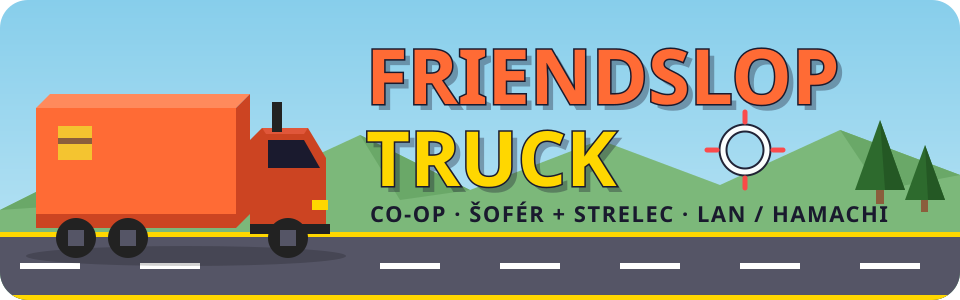
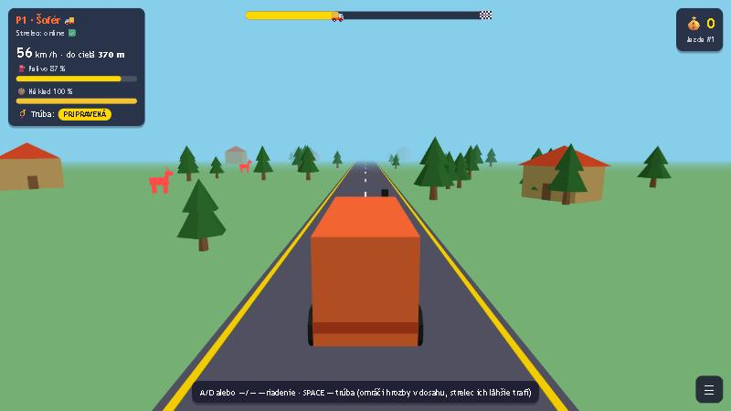
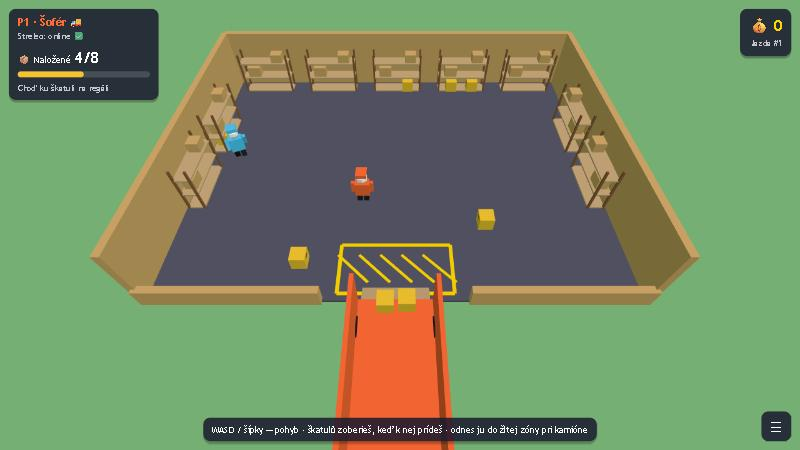
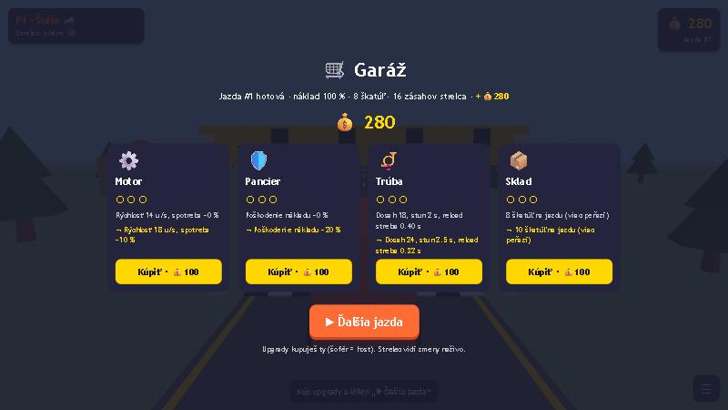
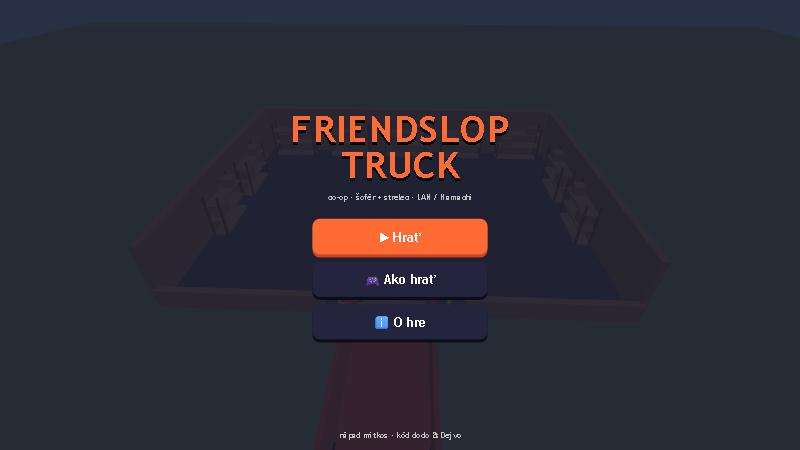

<p align="center">
  
</p>

<p align="center">
  <b>Low-poly co-op hra pre dvoch kamarátov.</b><br>
  Jeden šoféruje kamión, druhý ho strieľaním bráni na diaľnici plnej zveri a banditov.
</p>

<p align="center">
  
  
  
  
</p>

<p align="center">
  <a href="#-spustenie">Spustenie</a> ·
  <a href="#-ovládanie">Ovládanie</a> ·
  <a href="#-ako-sa-hrá">Ako sa hrá</a> ·
  <a href="#-tím">Tím</a> ·
  <a href="#-zmeny">Zmeny</a>
</p>

<p align="center">
  
</p>

---

## 🎮 O hre

**Friendslop Truck** je kooperatívna hra pre 2 hráčov cez LAN alebo Hamachi. Grafika je zámerne naivná:
plochý low-poly štýl, žiadne textúry, výrazné farby.

| Rola | Kto | Čo robí |
|---|---|---|
| 🚚 **Šofér** | prvý pripojený hráč | nosí škatule, riadi kamión, trúbi a nakupuje upgrady |
| 🎯 **Strelec** | druhý pripojený hráč | pomáha nosiť škatule a myšou strieľa hrozby na ceste |

<table>
  <tr>
    <td width="50%"><p align="center"><b>1 · Sklad</b> — naložte kamión</p></td>
    <td width="50%"><p align="center"><b>3 · Garáž</b> — kúpte upgrady</p></td>
  </tr>
</table>

## 🚀 Spustenie

Netreba nič buildovať: stačí Node.js na serveri a prehliadač.

### 🖥️ Host (spúšťa server)

1. Nainštaluj [Node.js 18+](https://nodejs.org) a [Hamachi](https://vpn.net)
2. V Hamachi: **Sieť → Vytvoriť novú sieť**, daj meno a heslo kamarátovi
3. V priečinku hry spusti:
   ```bash
   npm install
   node server.js
   ```
4. Otvor `client.html` v prehliadači → **▶ Hrať** → nechaj `localhost` → **Pripojiť**
5. Svoju Hamachi IP (`25.x.x.x`, vidíš ju hore v Hamachi) pošli kamarátovi

### 🎧 Kamarát (pripája sa)

1. Nainštaluj Hamachi a pripoj sa do hostovej siete
2. Otvor `client.html` → **▶ Hrať** → napíš Hamachi IP hosta → **Pripojiť**
3. Počkaj na „Pripojený ako Strelec 🎯“ a hra sa spustí sama

> [!TIP]
> IP sa dá zadať aj natrvalo v `client.html` (konštanta `HOST_IP`) alebo v adrese: `client.html?host=25.x.x.x`.

> [!NOTE]
> Server beží na porte **3000** (`PORT` hore v `server.js`). Ak sa kamarát nevie pripojiť, povoľ Node.js
> vo **Windows Firewalle** (aspoň pre súkromné siete).

## ⌨️ Ovládanie

| | 📦 Sklad | 🛣️ Diaľnica |
|---|---|---|
| 🚚 **Šofér** | `WASD` / šípky | `A` `D` alebo `←` `→` riadenie · `SPACE` trúba |
| 🎯 **Strelec** | `WASD` / šípky | myš mieri · ľavé tlačidlo strieľa · `Esc` uvoľní myš |
| **Obaja** | `Esc` / ☰ menu | `Esc` / ☰ menu |

## 🗺️ Ako sa hrá

1. **📦 Sklad** — škatule ležia na regáloch. Prídeš k nim a zoberú sa samé. Odnes ich do **žltej zóny** pri kamióne.
   Keď je naložené všetko, vyráža sa.
2. **🛣️ Diaľnica** — 600 m do cieľa. Cez cestu skáče **zver** a z krajnice sa vrhajú **bandity**.
   Každý náraz zničí časť nákladu. Keď je náklad na nule, je koniec hry.
   > Šofér zatrúbi → hrozby v dosahu sa zastavia → strelec ich ľahko trafí. Spolupráca je všetko.
3. **🛒 Garáž** — za doručený náklad dostanete 💰. Šofér kupuje upgrady a spustí ďalšiu jazdu.

| Upgrade | Čo robí (za level, max 3) |
|---|---|
| ⚙️ Motor | +4 rýchlosť, nižšia spotreba |
| 🛡️ Pancier | −20 % poškodenia nákladu |
| 📯 Trúba | väčší dosah, dlhší stun, rýchlejšie strieľanie |
| 📦 Sklad | +2 škatule na jazdu = viac peňazí |

Ceny: 💰100 → 💰200 → 💰350. Ak niekto vypadne, hra sa pozastaví a **10 s** čaká, kým sa vráti.

## 👥 Tím

| | |
|---|---|
| 💡 **Nápad** | **mitkos** |
| 💻 **Kód** | **dodo** a **Dejvo** |

## 🧩 Ako to funguje

```
 client.html (Šofér)  ──input──▶               ◀──input──  client.html (Strelec)
                                 server.js
                      ◀──stav──  20× za sek.   ──stav──▶
```

- **`server.js`** — Node.js + [`ws`](https://github.com/websockets/ws). Rozhoduje o všetkom: hrozby, zásahy, náklad, peniaze.
  Klienti posielajú len input a svoju polohu. Server ju preberá najviac rýchlosťou chôdze, takže sa nedá teleportovať.
- **`client.html`** — jeden súbor, [Three.js](https://threejs.org) r168 z CDN. Vykresľuje hru, vlastný pohyb počíta
  plynulo každý snímok.

## 📝 Zmeny

<details open>
<summary><b>v1.2</b> — oprava pádu, menu, logo</summary>

**Prečo hra padala:** v úprave „pls fixv1“ sa v `client.html` omylom rozbili dve veci:

1. Funkcia `onPhaseChange` sa ocitla **vnorená sama v sebe**. Vonkajšia funkcia nerobila nič, takže hra sa nikdy
   neprepla na diaľnicu: šofér nevidel cestu, nemohol riadiť a po chvíli zrážky zničili náklad → koniec hry.
2. Z `updateDriving` zmizol výpočet vzdialenosti a premenná `tz`. Keby sa jazda zobrazila,
   každý snímok by spadol na `tz is not defined` a obraz by zamrzol.

**Opravené:**
- `onPhaseChange` je zase jedna funkcia; výpočet vzdialenosti a `tz` je späť.
- Vlastná postavička začína tam, kam ju postaví server, aj v každom novom kole.
- Plynulý pohyb zo „pls fixv1“ ostal, ale server preberá polohu najviac rýchlosťou chôdze/riadenia
  (+50 % rezerva na lag), berie len platné čísla a na začiatku kola zabudne staré polohy.
- Poistky: zlá správa nezhodí server, chyba v jednom snímku nezastaví hru (vypíše sa do konzoly, `F12`).
- Otestované: 4 kolá za sebou s botmi + celé kolo v prehliadači.

**Nové:**
- Hlavné menu: **▶ Hrať**, **🎮 Ako hrať**, **ℹ️ O hre**.
- Menu počas hry (☰ / `Esc`) s možnosťou **Odpojiť sa**.
- Logo, ikona v karte prehliadača a toto README.

<p align="center"></p>
</details>

<details>
<summary><b>v1.1</b> — „pls fixv1“ (Dominik)</summary>

- Plynulý pohyb: vlastnú postavičku v sklade a kamión šoféra počíta klient každý snímok a posiela serveru polohu.
  Predtým sa čakalo na server (20× za sekundu), takže pohyb trhal.
</details>

<details>
<summary><b>v1.0</b> — prvá verzia</summary>

- Sklad → diaľnica → garáž, 2 hráči cez LAN / Hamachi.
</details>

---

<p align="center"><sub>Vyrobené s 🧡 · nápad mitkos · kód dodo &amp; Dejvo</sub></p>
